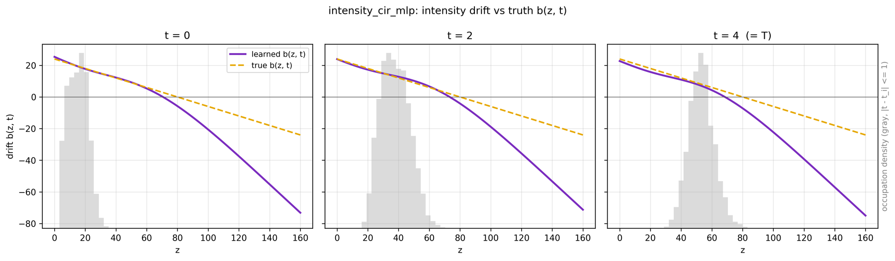
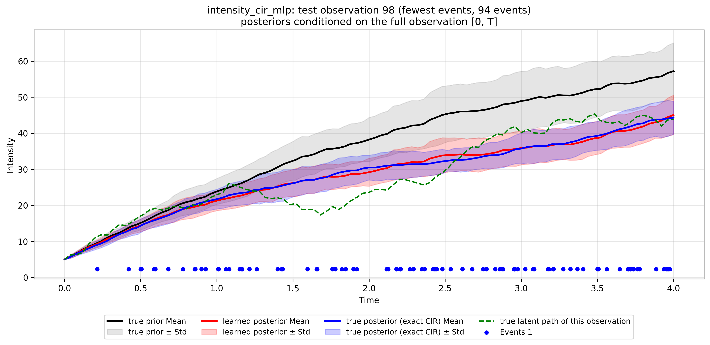
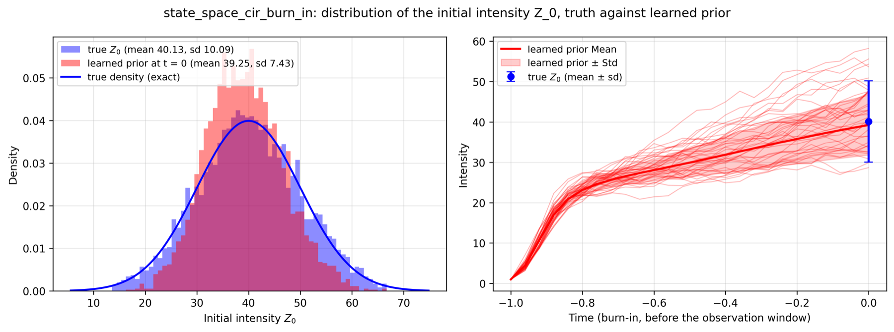
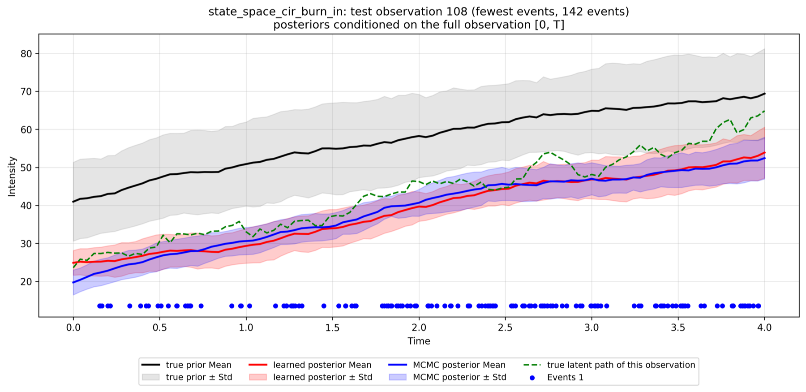
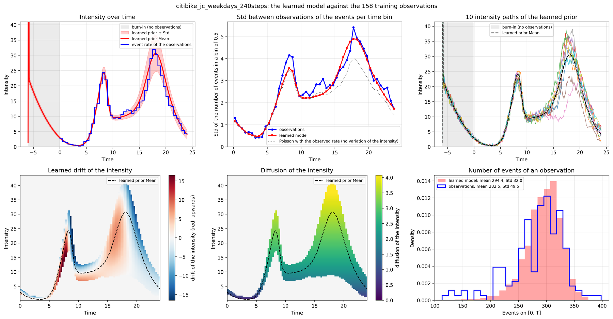
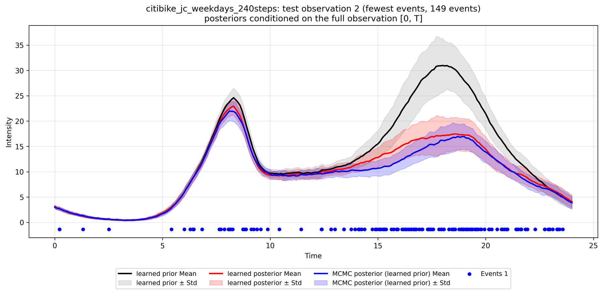

# NDIM — Neural Diffusion Intensity Models for Point Process Data

This repository includes a PyTorch implementation of the paper:

> Xinlong Du, Harsha Honnappa, Vinayak Rao. *Neural Diffusion Intensity Models for Point Process Data.*
> UAI 2026, PMLR 337:1448–1473. https://proceedings.mlr.press/v337/du26a.html

where we present a framework for learning the latent prior/posterior intensity dynamics of a diffusion-driven Cox process (DDCP). A DDCP is a Poisson process with latent diffusive intensity `Z` which is a weak solution to the stochastic differential equation (SDE):

`dZ_t = b_theta(Z_t, t) dt + sigma(Z_t, t) dB_t`

The package learns the prior drift `b_theta` together with an amortised posterior: the same SDE with an additional drift correction `sigma u_beta`, where the network `u_beta` takes the observed events as inputs. Both networks are trained simultaneously by maximizing the evidence lower-bound (ELBO).

## What you can do with this code

Suppose you have `n` i.i.d. observations of temporal point processes on the interval `[0, T]`, where the `i`th observation consists of event times `[t_1, t_2, ..., t_{k_i}]` which may not have the same length. This could be the call times throughout a day at a call center, the arrival times of customers at a store, emission times of some signal, etc. With this repository, you can:

* **Fit the model to your own data with one command.** It learns the latent dynamics driving your observations, and produces descriptive figures showing how the latent dynamics vary over time. See [Fit your own data](#fit-your-own-data).
* **Infer the intensity behind an observation.** The trained model finds posterior paths of the intensity given the events of an observation, by forward simulating the posterior SDE (without MCMC). Given only the first part of the window, it forecasts the rest. It also generates new observations from the learned dynamics. See [Using a trained model](#using-a-trained-model).
* **Run the four experiments of this repository**: Two of them are experiments on synthetic data, where the result can be checked against the ground truth; the other two are experiments on real-world data. See [Included experiments](#included-experiments).
* **Tweak the model yourself.** Drift, diffusion, posterior network, training and evaluation are all settings of a config file which you can modify. See `configs/base.yaml` and `ndim/config.py`.

## Installation

To install, run (in the repository root):
```bash
python3 -m pip install -r requirements.txt
```

The current implementation requires Python ≥ 3.9, PyTorch ≥ 2.1. Optionally, you may run the following command to make sure the installation is successful.

```bash
python3 -m pytest tests
```

## Fit your own data

Write the event times of every observation into a file, one observation per line. The event times are measured from the start of its window, so if a dataset contains inter-arrival times (times in between events) it must be converted to event times first. Compatible file formats: (`.csv`, `.txt`, `.json`, `.npy` and `.npz`):

An example file with three observations may look like (usually needs more than a few dozens):
```text
0.52,1.31,1.48,3.95,7.20
0.20,2.07,6.61
1.10,1.27,1.33,2.90,4.11
```

Run the following command to fit the model to your own data at `path_to_dataset/my_events.csv`:

```bash
python3 scripts/fit.py path_to_dataset/my_events.csv --T 24
```

The length of the observation window `--T` must be specified. For example, use `--T 24` if the events are recorded in 24-hour time. The command automatically holds out a quarter of the observations for testing, and outputs are written to `outputs/my_events/`:

| in `outputs/my_events/` | what it is |
|---|---|
| `RESULTS.md` | what was run, the main numbers and the figures: start here |
| `eval/learned_model.png` | the learned model against your observations: event rate over time, spread between observations, paths, drift and diffusion |
| `eval/posterior_*.png` | the intensity behind single test observations, against MCMC |
| `eval/metrics.json` | every number of the evaluation |
| `ckpt_best.pt` | the trained model |

**Nothing about the intensity has to be specified:** 

* the **state-space parametrization**: the SDE is written for the latent state `X = log Z`, so the intensity `Z = exp(X)` is positive whatever the networks return;
* an **MLP drift** `b_theta(x, t)`;
* the **CIR diffusion** `eta sqrt(Z)` of the intensity (for `X` it is `eta exp(-X/2)`), fixed and not trained: the coefficient `eta` is estimated from the observations before training;
* a **burn-in** period before the observation window, through which the distribution of the initial intensity is learned.

Before training, the command prints an estimate of `eta` and its 95% interval. Here, we also include some options the user may choose:

| option | what it does |
|---|---|
| `--eta 0.5` | set the coefficient of the diffusion manually |
| `--diffusion cir-learned` | keep the form `eta sqrt(Z)`, but train `eta` with the model instead of estimating it beforehand |
| `--diffusion network` | assume no form: the diffusion of `X = log Z` is a neural network `sigma(x, t)`, trained with the model |
| `--diffusion unit` | fix the diffusion of `X = log Z` at the constant 1, not trained |
| `--steps 120` | Euler steps on `[0, T]` (default 100); take more when `RESULTS.md` says that the learned drift is too stiff for the grid |
| `--epochs 60` | training epochs (default 100) |
| `--profile laptop` | smaller evaluation sizes for an 8 GB machine |

## Included experiments

| | 1. CIR, intensity parametrization | 2. CIR, state-space parametrization | 3. U.S. bank call centre | 4. Citi Bike trips |
|---|---|---|---|---|
| what it shows | the model of the original paper, where a fixed, known initial intensity is assumed (Sec. 4.1) | unknown initial intensity distribution, learned through a burn-in | the default model on the call-centre arrivals of the paper (Sec. 4.4) | the default model on public data |
| data | synthetic: `dZ = 0.3(80 - Z) dt + sqrt(Z) dB`, `Z_0 = 5`, on `[0, 4]` | synthetic: the same dynamics, `Z_0` normal with mean 40 and standard deviation 10, truncated to `[5, 75]` | calls at a U.S. bank, one observation per day | trip starts of Citi Bike in Jersey City, one observation per weekday (a script fetches the public files) |
| state of the SDE | the intensity `Z` (intensity parametrization) | `X = log Z` (state-space parametrization) | `X = log Z` | `X = log Z` |
| where a path starts | at the known `Z_0 = 5` | at `X = 0` (intensity 1) at `t = -1`; nothing is observed before time 0 | at `t = -T/4`, from the event rate at the start of the window | at `t = -T/4`, from the event rate at the start of the window |
| drift | MLP `b_theta(z, t)` | MLP `b_theta(x, t)` | MLP `b_theta(x, t)` | MLP `b_theta(x, t)` |
| diffusion | `sqrt(Z)`, known | `sqrt(Z)`, known; for `X` it is `exp(-X/2)` | `eta sqrt(Z)` with `eta = 0.322`, estimated from the data and not trained | `eta sqrt(Z)` with `eta = 0.665`, estimated from the data and not trained |
| posterior compared with | the exact CIR posterior | MCMC (pCN) under the true prior | MCMC (pCN) under the learned prior | MCMC (pCN) under the learned prior |
| run it with | `experiments/intensity_cir_mlp.py` | `experiments/state_space_cir_burn_in.py` | `scripts/prepare_usbank.py`, then `scripts/fit.py` | `scripts/prepare_citibike.py`, then `scripts/fit.py` |

Experiments 1 and 2 generate their data, train and evaluate. Both use 256 training and 128 test observations, 100 Euler steps on `[0, 4]`, SiLU activation, mini-batches of 16 observations and 8 Brownian paths per observation. 

The documentation and the configs call them *example 1*, *example 2*, etc.

### Running the included experiments

Each synthetic experiment has a wrapper in `experiments/` that runs it end to end by calling the scripts of `scripts/` in order: it generates the dataset, then trains and evaluates. On an 8 GB laptop, add the option `--profile laptop` (`configs/laptop.yaml`: smaller evaluation sizes).

Experiment 1, a known initial intensity (paper Fig. 2–4):

```bash
python3 experiments/intensity_cir_mlp.py --profile laptop
```

Experiment 2, an unknown initial intensity learned through a burn-in:

```bash
python3 experiments/state_space_cir_burn_in.py --profile laptop
```

Experiment 3, the call-center data. The file comes from the SEE Lab at the Technion (https://seelab.net.technion.ac.il/data/). The first command turns it into one observation per day and prints the estimated coefficient `eta`:

```bash
python3 scripts/prepare_usbank.py --csv /path/to/usbank_calls_byminute.csv
```

```bash
python3 scripts/fit.py data/usbank_friday.npz --steps 240 --epochs 60 --eta 0.322 --set train.batch_size=8
```

Experiment 4, the bike trips. The first command fetches ten monthly files (about 37 MB) from Citi Bike (https://citibikenyc.com/system-data; the Citi Bike data licence applies).

```bash
python3 scripts/prepare_citibike.py --download
```

```bash
python3 scripts/fit.py data/citibike_jc_weekdays.npz --steps 240 --epochs 60 --eta 0.665 --set train.batch_size=8
```

### Expected results

The figures are from our runs on an 8 GB M3 MacBook Air (CPU).

**Experiment 1** (100 epochs, a little less than an hour). The learned drift against the true drift at three times `t=0,2,4`. The gray histograms show the distribution of the intensity at that time: the two drifts agree there, and no data provides information outside.



The posterior of the intensity given the test observation with the fewest events: the learned posterior against the exact CIR posterior. The dashed green line is the intensity path that generated the observation.



**Experiment 2** (150 epochs, 2 hours 40 minutes). Left: the learned distribution of the initial intensity against the true one. Right: the paths of the burn-in that produce it, from intensity 1 at `t = -1`.



The posterior given the test observation with the fewest events, against MCMC under the true prior. With a burn-in, the posterior of `Z_0` also depends on the observation.



**Experiment 4** (60 epochs; a bit over three hours). The learned prior with 158 training observations. The figures in order: the event rate over the day, the spread of the counts between days, paths of the learned prior, the learned drift and the diffusion, and the number of events per day. The gray part before time 0 shows the burn-in period.



The posterior of the intensity given the test day with the fewest events, against MCMC under the learned prior:



Since the data file of Experiment 3 is not distributed, we won't include any figures here.

The figures of a synthetic experiment, in `outputs/.../eval/`:

| What | Experiment | Output in `outputs/<name>/eval/` |
|---|---|---|
| learned against true drift | 1 and 2 | `drift_comparison.png`, `drift_heatmap.png`, `drift_3d.html` |
| generated against true counts | 1 and 2 | `generated_vs_true_counts.png` |
| posterior paths against the reference, with the intensity path that generated the observation | 1 and 2 | `posterior_{fewest,most}_events_{full,partial}.png` |
| learned against true distribution of the initial intensity | 2 | `initial_distribution.png` |
| Wasserstein distance between the learned and the reference posterior | 1 and 2 | `wasserstein.png` |
| numerical data | 1 and 2 | `metrics.json` |

## Using a trained model

Once a model is fitted to your data, it is saved as `outputs/<data_name>/ckpt_best.pt`. Load it, and it answers questions about the intensity by simulation. Every answer is a set of intensity paths on `[0, T]`: one row per path, one column per time in `model.times`.

```python
from ndim.model import NDIM

model, _ = NDIM.load_checkpoint("outputs/my_events/ckpt_best.pt")
t = model.times                                   # the times of the columns: 0, dt, 2 dt, ..., T
```

**How does the prior intensity behave?** Sample intensity paths from the learned prior:

```python
prior = model.prior_paths(200)                    # 200 paths: a tensor of shape [200, len(t)]
```

**What was the intensity behind one observation?** Conditioned on an observation of event times, the paths are a sample of the posterior given these events, via forward simulating the posterior SDE:

```python
events = [0.7, 1.9, 2.4, 3.3]                     # the event times of the observation, in (0, T]
posterior = model.posterior_paths(events, 200)
mean = posterior.mean(dim=0)                      # the estimate of the intensity at every time in t
low, high = posterior.quantile(0.05, dim=0), posterior.quantile(0.95, dim=0)    # a 90% band around it
```

**Future forecast** If an observation is known only up to some time `T'=12.0`, the paths after that time are a forecast:

```python
forecast = model.posterior_paths(events, 200, observed_until=12.0)    # given the events on [0, 12] only
```

**What would new data look like?** New observations can be drawn from the learned model, and each is an array of event times:

```python
new = model.generate_observations(5)
```

**To visualize a result:**

```python
import matplotlib.pyplot as plt

plt.fill_between(t, low, high, alpha=0.3)
plt.plot(t, mean)
plt.plot(events, [0.0] * len(events), "|", color="black")     # the events
plt.xlabel("time"); plt.ylabel("intensity"); plt.savefig("posterior.png")
```
